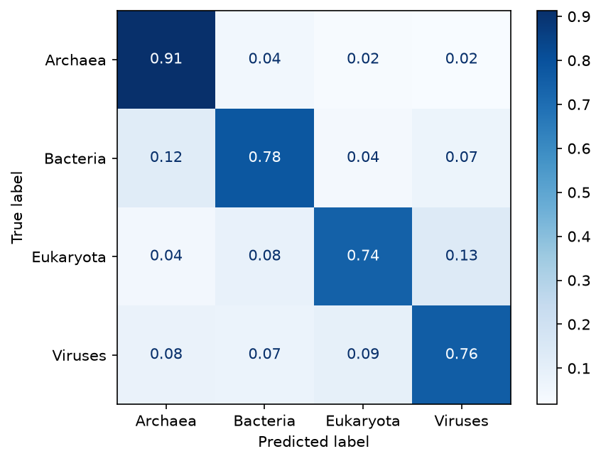

# Model Card — GenoScope superkingdom classifier

## Task
Predict the superkingdom (Archaea, Bacteria, Eukaryota, Viruses) of a 1,500 bp DNA fragment from its
tetranucleotide (4-mer) composition. Longer sequences are split into 1,500 bp windows; window probabilities are averaged.

## Data
- **Source:** BERTax "non-similar" dataset (Mock et al., *PNAS* 2022, [OSF qg6mv](https://osf.io/qg6mv/)) —
  1,500 nt fragments from NCBI RefSeq genomes, with test genera absent from training.
- **Labels:** derived from each fragment's NCBI taxid via the NCBI taxonomy dump (`taxopy`).
- **Train:** first 600 MB of `train.fa` (~396k fragments; records are shuffled), balanced to 25,000 fragments
  per class (100,000 total) from 5,185 taxa (Archaea 255, Bacteria 2,567, Eukaryota 248, Viruses 2,115).
- **Test:** `test.fa`, 5,000 fragments per class from 197 taxa (Archaea 4, Bacteria 72, Eukaryota 17, Viruses 104).
  **No taxid is shared between train and test.**

Rebuild with `uv run --group ml python ml/download_data.py && uv run --group ml python ml/prepare_data.py`.

## Model
scikit-learn `Pipeline`: `CountVectorizer` (256 ACGT 4-mers) → L1 normalisation (frequencies) → `StandardScaler` → classifier.
Selected by `GridSearchCV` with 3-fold `GroupKFold` grouped by taxid (macro F1):

| Classifier | CV macro F1 |
|---|---|
| Logistic regression | 0.751 |
| Random forest (300 trees) | 0.774 |
| **HistGradientBoosting** (selected) | **0.821** |

## Test results (unseen genera, per 1,500 bp fragment)

| Class | Precision | Recall | F1 |
|---|---|---|---|
| Archaea | 0.79 | 0.91 | 0.85 |
| Bacteria | 0.80 | 0.78 | 0.79 |
| Eukaryota | 0.83 | 0.74 | 0.78 |
| Viruses | 0.78 | 0.76 | 0.77 |
| **Macro avg** | **0.80** | **0.80** | **0.80** |

Main confusions: Bacteria → Archaea (12%), Eukaryota → Viruses (13%). Viruses are hardest — viral genomes often
mimic their hosts' composition.

## Limitations
- Composition only: no alignment or database lookup, so related-but-distinct clades can be confused.
- Archaea test set has only 4 taxa; its recall estimate is noisy.
- Trained on nuclear/genomic fragments; plasmids, organelles and synthetic constructs are out of scope.
- Inputs shorter than 1,000 bp get no prediction; confidence on single windows is modest.
- For comparison, BERTax (a transformer) reports higher accuracy on this task; this model trades accuracy for
  being tiny (< 1 MB), fast on CPU and explainable via the k-mer profile.
